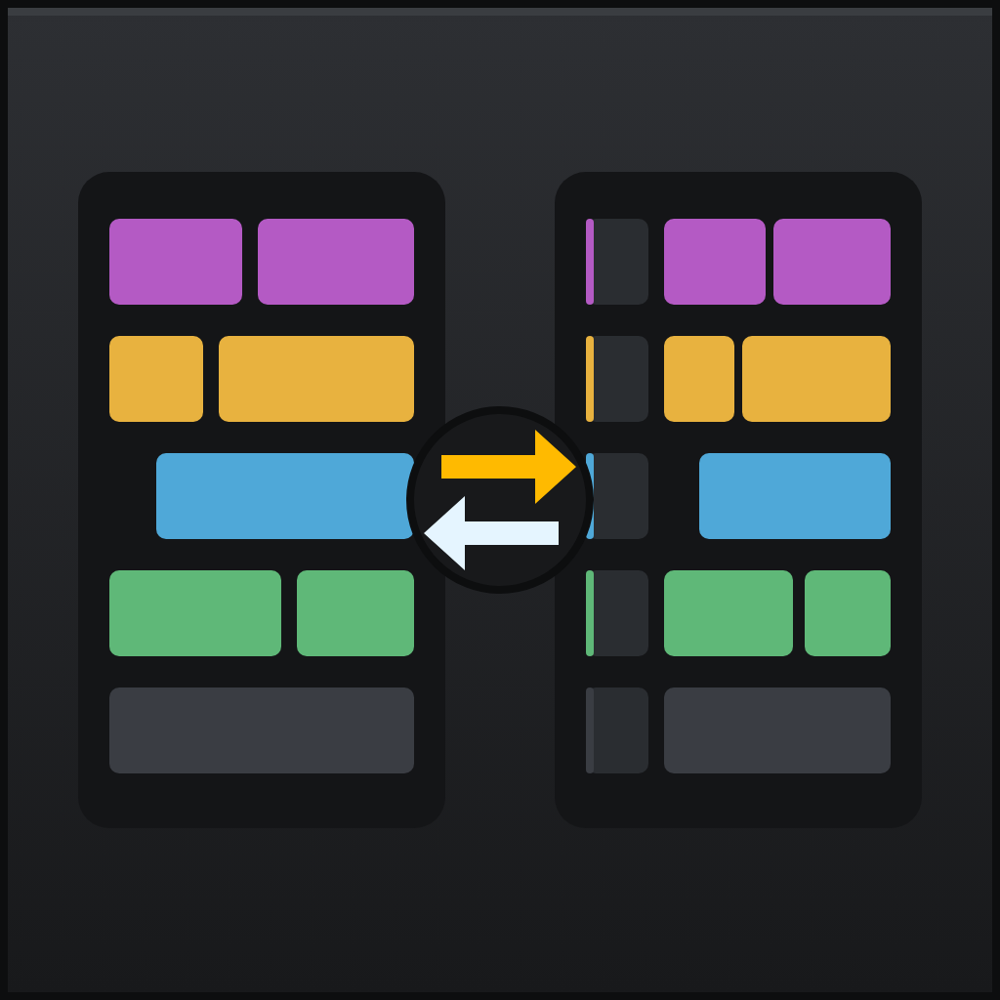
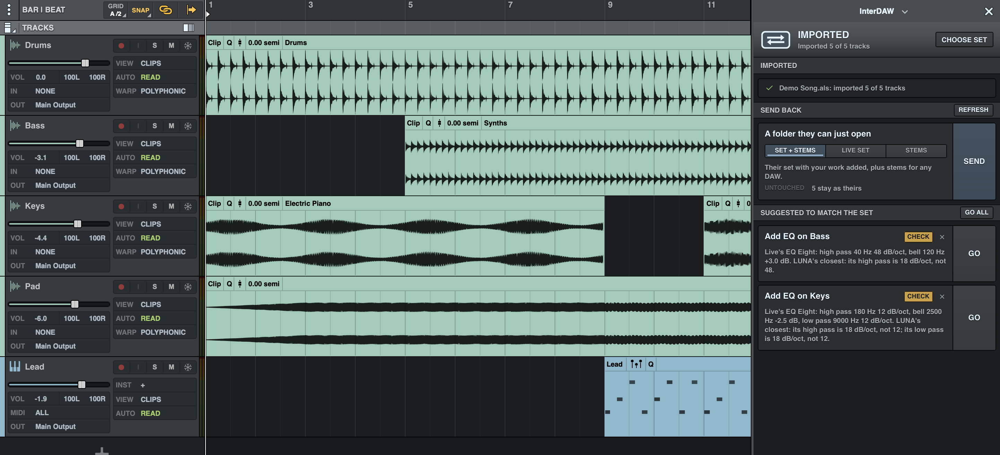
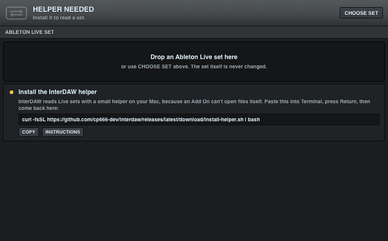
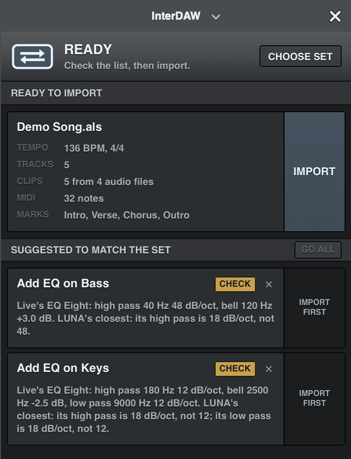

#  InterDAW

Open an Ableton Live set in LUNA. InterDAW brings in the tracks, clips, MIDI, tempo, meter,
markers, levels and mutes, suggests UADx plug-ins to get closer to how the set sounded in Live,
and sends your work back as a Live set, as stems for any DAW, or both. Your original set is never
changed.



Requires LUNA 3.1.2 or later on macOS, and the free InterDAW helper (one command, below).

## Install

1. Install InterDAW from **Discover** on [UA Universe](https://universe.uaudio.com/) or in LUNA.
   Or download `InterDAW.lunaaddon` from this repository's latest
   [release](https://github.com/cp666-dev/interdaw/releases/latest) and double-click it.
2. Open **Add Ons > Browsers > InterDAW** in LUNA.
3. Install the helper, as the panel asks. See below.

### Install the helper



A LUNA Add On can't open files on your Mac, so InterDAW reads Live sets with a small helper app.
Open **Terminal** (in Applications > Utilities), paste this line and press Return:

```bash
curl -fsSL https://github.com/cp666-dev/interdaw/releases/latest/download/install-helper.sh | bash
```

The panel shows the same line, with a **COPY** button. Within a few seconds the panel says READY.

What it does:

- Installs **InterDAW Helper** in `~/Library/Application Support/InterDAW` and starts it, now and
  each time you log in. It has no window or Dock icon.
- Uses the Python that comes with Apple's Command Line Tools. If you don't have them, macOS
  offers to install them; run the line again when that finishes.
- Listens only on your Mac (`127.0.0.1:8792`) and answers only the InterDAW panel. It reads the
  sets you open, writes only into the folders you choose for Send Back, and sends nothing over
  the internet.

The first time you open a set from Desktop, Documents or Downloads, macOS asks whether
"InterDAW Helper" may access that folder. Choose **Allow**.

## Use

Start in a **new, empty session**. An import sets the session's tempo and meter, and it isn't a
single undo step.



1. **Drop a `.als` file** on the panel, or use **CHOOSE SET**. You don't need Live installed,
   only the set and its audio files.
2. Check the summary, then press **IMPORT**. Audio is copied into the LUNA session.
3. **Suggested to match the set**: each suggestion shows what Live had and the closest LUNA
   can get. Press **GO** to run one, or **GO ALL**. Running one twice changes nothing further.
   Suggestions use UADx SSL E Channel Strip, API Vision Channel Strip, Pure Plate and Galaxy
   Tape Echo. Importing works without them.
4. **Send Back**: choose **SET + STEMS**, **LIVE SET** or **STEMS**, press **SEND** and pick a
   folder. InterDAW makes a new folder there that needs no LUNA or UAD plug-ins to open:
   - **LIVE SET**: their set with your changes. Tracks you changed are printed from LUNA, with the
     original kept beside them, muted.
   - **STEMS**: every track as audio from bar 1, for any DAW.
   - **SET + STEMS**: both.
   Each folder has a `Read Me.txt` saying what changed, plus `Mix Reference.wav`, how it
   sounded in LUNA.

InterDAW remembers which set a session came from, so reopening the session reopens the set.

### What comes across

| From Live | In LUNA |
|---|---|
| Audio tracks and clips, including looped and trimmed clips | Audio tracks with the same clips at the same times |
| MIDI tracks and notes | Instrument tracks with the notes |
| Tempo and time signature | The session's tempo and meter |
| Locators | Markers |
| Track volume and mute, clip gain and fades | The same, on the LUNA tracks and clips |
| EQ Eight, Auto Filter, reverbs, delays, return tracks, track colours | Suggestions you run with GO |

Anything that can't be matched is listed in the panel under **CAN'T MATCH YET**. Audio the set
refers to but that isn't on this Mac is listed under **MISSING AUDIO**; those clips are skipped.

## Troubleshooting

- **HELPER NEEDED** stays on: run the install line again. Check that the helper answers:

  ```bash
  curl -H "Origin: ua-content://com.cp.interdaw" http://127.0.0.1:8792/health
  ```

  It should print `"ok": true`. Logs are in `~/Library/Logs/InterDAW`.
- **HELPER OUT OF DATE**: your helper is from another version of InterDAW. Run the install line
  again to update it.
- **A set won't open from a folder**: allow "InterDAW Helper" in System Settings > Privacy &
  Security > Files and Folders.

Report a problem in [Issues](https://github.com/cp666-dev/interdaw/issues), with your macOS,
LUNA and Live versions, what you did, and `helper.log` from the logs folder. Attach a set only if
you're free to share it.

## Uninstall

Remove the helper:

```bash
curl -fsSL https://github.com/cp666-dev/interdaw/releases/latest/download/uninstall-helper.sh | bash
```

Then remove InterDAW in LUNA's **Settings > Add Ons**. Your sets, sessions and anything Send Back
made are kept.

## Building from source

- `addon/`: the Add On, built with the [LUNA Builder SDK](https://github.com/uaudio-labs/luna-builder-sdk).
  `logic.js` holds the engine logic and is tested against `Luna.MockEngine`. `main.js` drives the page.
- `helper/`: the helper, Python 3.9 or later with no other packages.
- `scripts/build-release.sh`: runs every test, then writes the release files to `dist/`.

```bash
cd addon && npm install && npm test
```

```bash
cd helper && python3 -m unittest discover -s tests -t .
```

```bash
scripts/build-release.sh
```

To work on the panel in a browser, run the helper with `INTERDAW_DEV=1` so it answers
`ua-builder serve` (`http://localhost:8790`), then `npx ua-builder serve` in `addon/`.

## License

InterDAW is released under the [MIT License](LICENSE). The SDK bundle in `addon/vendor/` is
© Universal Audio, Inc., under the Apache License 2.0; its license and notice are beside it.
InterDAW is not made or endorsed by Ableton or Universal Audio.
